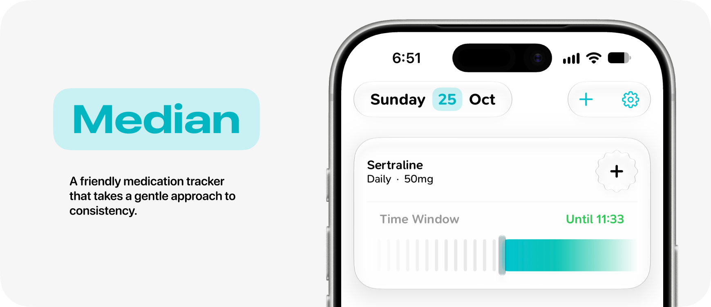

#  Median

---

Median is a medication tracker built in Swift and SwiftUI. It was built to help me stay more consistent in the times I take my meds every day (something I'm very bad at). I devised a novel 'time window' feature, that the user can install as a widget or view as a live activity.

Work in progress.
